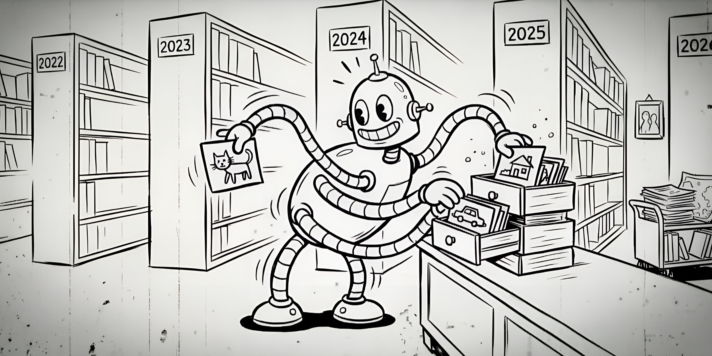

<p align="center">
  
</p>

# Memorier

A small toolkit to clean, sort, and organize your photos and videos by year and month. It also includes helpers to sync media between folders, pull files from an Android phone, and share a folder over FTP.

## Features

### memorier.py
- **Collect** supported images and videos from a folder
- **Remove** garbage files (trash, temp, cache, and long random names without a camera date or camera EXIF)
- **Skip** files that are exact copies, or that an earlier run already handled
- **Validate** images and drop corrupted files
- **Filter** low-resolution files (below 720px width or height) and videos shorter than 3 seconds
- **De-duplicate** near copies with perceptual hashes, and keep the best copy (camera EXIF, date, resolution, size)
- **Review** useless images: screenshots, stickers, memes, documents, blurry, dark, very similar, and images without camera EXIF go to `Review/<reason>`
- **Convert** HEIC and WebP to JPG (EXIF is kept), and AVI/MKV/MOV/WEBM to MP4 without re-encoding. If a video can not be stored in MP4, it stays in its original format
- **Organize** into `Photos/YYYY/MM-Month` and `Videos/YYYY/MM-Month`, with an `Unknown` folder when no date is found

### pcsync.py
- Compare two folders and copy media files that exist in the source but not in the destination (by filename)

### phonesync.py
- Pull new images and videos from an Android phone to your PC over ADB, and keep the phone's file dates

### sender.py
- Run a local FTP server so you can upload or browse files from another device on the same network

## Requirements

- Python 3.10+
- [ffmpeg](https://ffmpeg.org/) and ffprobe (for video metadata, frames, and conversions)
- Python packages (see [requirements.txt](requirements.txt)):
  - `pillow`, `pillow-heif`, `imagehash`, `numpy`, `tqdm` — core organizer
  - `torch`, `transformers` — image classification with CLIP
  - `pure-python-adb` — phone sync (`phonesync.py`)
  - `pyftpdlib` — FTP server (`sender.py`)
- For `phonesync.py`: [ADB](https://developer.android.com/tools/adb) installed and USB debugging enabled on the phone

The first run downloads the CLIP model (about 600 MB). CLIP uses the GPU if there is one; on a CPU it is much slower.

## Install

```bash
pip install -r requirements.txt
```

Install ffmpeg (includes ffprobe):

- **Windows:** [ffmpeg builds](https://www.gyan.dev/ffmpeg/builds/) — add `ffmpeg` and `ffprobe` to PATH
- **macOS:** `brew install ffmpeg`
- **Linux:** `sudo apt install ffmpeg` (or your distro equivalent)

For phone sync, install ADB and connect your device with USB debugging on.

## Setup

Copy `pathsexample.py` to `paths.py` and edit the folders in it. `paths.py` is in `.gitignore`, so your real paths never go to GitHub.

Limits and rules (minimum sizes, blur limit, CLIP labels, screen sizes) are in [config.py](config.py). Change `SCREEN_SIZES` to include your phone's screen size. Set `REVIEW_NO_CAMERA = False` to keep images without camera EXIF in `Photos` (for example photos received on WhatsApp).

None of the scripts take command-line arguments.

## Quick start — organize media

1. Set `memories_dir` (your mixed files) and `output_dir` (the organized result) in `paths.py`.
2. Run:

```bash
python memorier.py
```

Organized files are written into `output_dir`. Files in `memories_dir` are not changed.

Later runs only process new files. `output_dir/index.json` remembers every file that was handled, including the ones that were removed. If you change the limits and want to process everything again, start with an empty `output_dir`.

## Supported formats

- **Images:** `.jpg`, `.jpeg`, `.png`, `.heic`, `.webp`
- **Videos:** `.mp4`, `.avi`, `.mkv`, `.mov`, `.webm`

## Output structure

```
output_dir/
  index.json
  Photos/
    2024/
      01-January/
    Unknown/
  Videos/
    2024/
      01-January/
    Unknown/
  Review/
    screenshots/
    stickers/
    no-camera/
      2024/
        01-January/
```

Each `Review/<reason>` folder uses the same year and month structure. Check these folders yourself, then delete or keep what you want.

## Other scripts

### PC sync (`pcsync.py`)

Copies missing media from one folder to another (matched by filename).

1. Set `pc_from_dir` and `pc_to_dir` in `paths.py`.
2. Run:

```bash
python pcsync.py
```

### Phone sync (`phonesync.py`)

1. Connect the phone via USB with debugging enabled.
2. Set `phone_dirs` (folders on the phone) and `phone_dir` (local folder) in `paths.py`.
3. Run:

```bash
python phonesync.py
```

Only files whose names are not already in `phone_dir` are pulled. Files that fail are not kept, so the next run tries them again.

### FTP server (`sender.py`)

1. Set `share_dir` (folder to serve) in `paths.py`, and optionally `PORT`, `USERNAME`, and `PASSWORD` in [sender.py](sender.py).
2. Run:

```bash
python sender.py
```

3. On another device, connect to the printed host, port, username, and password with any FTP client.

## Notes

- De-duplication uses MD5 for exact copies, pHash for near copies, CLIP embeddings for similar photos, and pHash of 3 frames for videos.
- Dates are read in this order: EXIF/XMP or video tags, then the file name, then the file's modified time. Dates before 2000 or in the future are ignored; undated files go under `Unknown`.
- The garbage, corrupted, low-resolution and short-video filters drop files without any report. Only the `Review` folders keep what was set aside.
